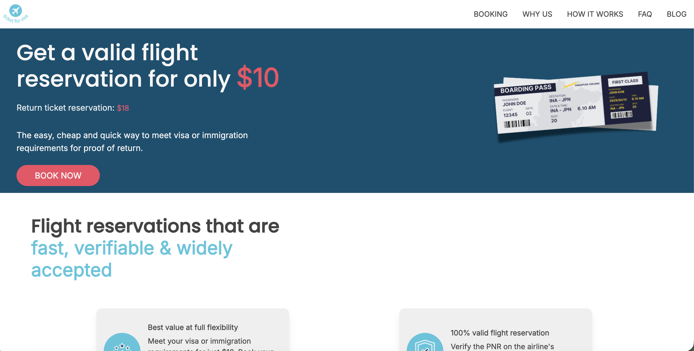
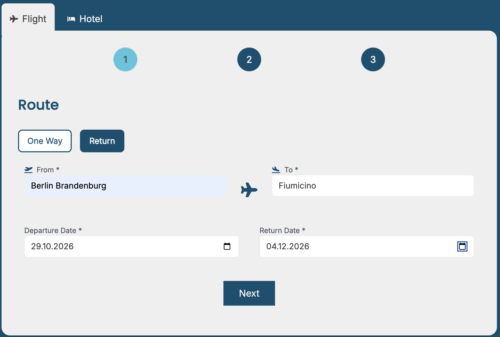
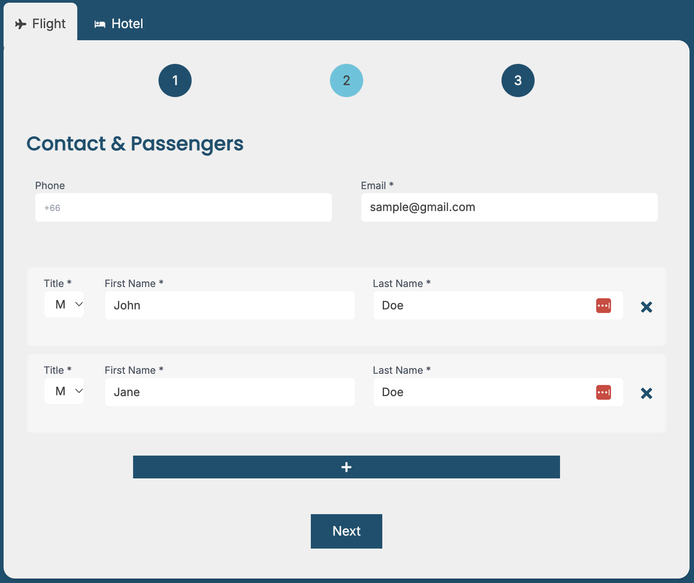

# TicketForVisa – Booking Web Application

A production web application developed for a client offering flight reservations for visa applications and international travel requirements.

**[Visit Live Website](https://www.ticketforvisa.com/)**

## Project Overview

The application allows customers to request flight reservations through a multi-step booking process, complete payment, and receive booking-related communication.

The project combines a customer-facing website with booking workflows, third-party integrations, and content management.

## Booking Flow

| Step 1 – Flight Selection | Step 2 – Passenger Details |
|:---:|:---:|
|  |  |

## My Role

Freelance Full-Stack Developer

My work included:

- Developing the website and multi-step booking interface using React and Next.js
- Implementing search-assisted form interactions with Fuse.js
- Integrating PayPal for online payments
- Building automated email workflows using Resend
- Integrating Contentful for content management
- Working with Redis and supporting application services
- Setting up deployment and analytics integrations

## Tech Stack

- **Frontend:** React, Next.js
- **Search:** Fuse.js
- **Payments:** PayPal
- **Email:** Resend
- **Data / Services:** Redis
- **CMS:** Contentful

## Live Application

[www.ticketforvisa.com](https://www.ticketforvisa.com/)

## Source Code

This is a showcase repository for a commercial client project. The application is live, but its source code is maintained in a private repository.

